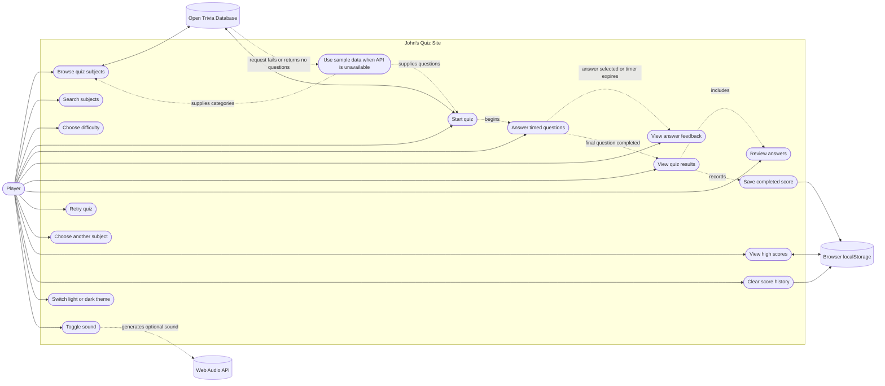

# Use-Case Diagram

This diagram shows the player's interactions with John's Quiz Site and the site's external services.

## Use-case notes

- The player browses and searches categories, chooses a difficulty, and starts a quiz.
- The player answers timed questions and receives feedback for selected answers or timeouts.
- Completing the quiz displays the score and answer review, then saves the result in browser storage.
- The player can retry, choose a different subject, view saved scores, or clear score history.
- The Open Trivia Database provides categories and questions. Built-in sample data is used when the API is unavailable or returns no questions.
- Sound effects use the browser's Web Audio API when enabled. Theme selection is handled within the app.
